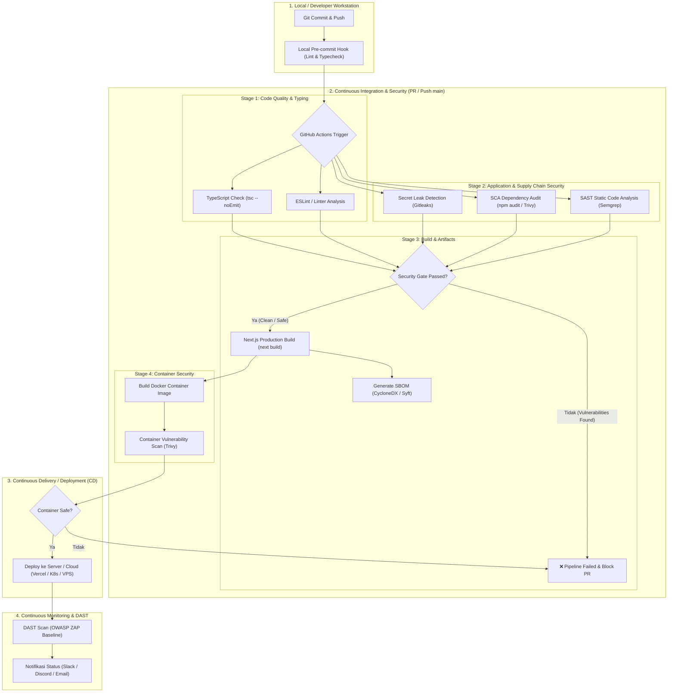

# 🛡️ Panduan & Dokumentasi DevSecOps CI/CD Pipeline
## Proyek: Vault Ijazah Digital (`vault-ijazah-digital-phase1`)

Dokumen ini memuat arsitektur, tahapan, konfigurasi, dan kebijakan keamanan untuk implementasi pipeline **Continuous Integration, Continuous Delivery, dan Continuous Security (DevSecOps)** pada aplikasi **Vault Ijazah Digital**.

---

## 📑 Daftar Isi
1. [Prinsip & Filosofi DevSecOps](#1-prinsip--filosofi-devsecops)
2. [Diagram Alur Pipeline](#2-diagram-alur-pipeline)
3. [Matriks Tools Keamanan](#3-matriks-tools-keamanan)
4. [Tahapan Rinci Pipeline (Stages)](#4-tahapan-rinci-pipeline-stages)
5. [Kebijakan Security Gate (Quality Gate)](#5-kebijakan-security-gate-quality-gate)
6. [Implementasi GitHub Actions Workflow](#6-implementasi-github-actions-workflow)
7. [Variabel Lingkungan & Secrets](#7-variabel-lingkungan--secrets)
8. [Panduan Menjalankan Security Check Lokal](#8-panduan-menjalankan-security-check-lokal)
9. [Branch Protection & Best Practices](#9-branch-protection--best-practices)

---

## 1. Prinsip & Filosofi DevSecOps

Aplikasi **Vault Ijazah Digital** menangani integritas data ijazah melalui cryptographic hashing (SHA-256) dan dynamic QR Code. Karena aspek integritas dan autentisitas adalah aset paling krusial, keamanan tidak boleh menjadi pemikiran akhir (*afterthought*), melainkan diterapkan dengan prinsip:

- **Shift-Left Security**: Pengujian keamanan dijalankan sedini mungkin pada siklus hidup perangkat lunak (mulai dari commit lokal, pull request, hingga build artefak).
- **Automated Quality & Security Gates**: Setiap *Pull Request* ke branch `main` wajib lolos pemeriksaan tipe TypeScript, analisis kerentanan paket dependensi, pemindaian rahasia (*secret scan*), dan analisis kode statis (*SAST*).
- **Immutability & Traceability**: Setiap build menghasilkan artefak dan *Software Bill of Materials* (SBOM) yang terlacak untuk menjamin integritas rantai pasok (*software supply chain*).
- **Fail-Fast Policy**: Jika ditemukan kebocoran secret atau kerentanan berstatus *HIGH/CRITICAL*, pipeline otomatis membatalkan proses deployment (*break the build*).

---

## 2. Diagram Alur Pipeline

Berikut adalah visualisasi alur otomatisasi DevSecOps dari kode sumber hingga siap disebarkan ke lingkungan produksi:



---

## 3. Matriks Tools Keamanan

| Domain Keamanan | Alat / Tools | Tujuan & Cakupan | Tingkat Toleransi Kegagalan |
| :--- | :--- | :--- | :--- |
| **Code Integrity & Typing** | TypeScript (`tsc`) | Validasi tipe data ketat, mencegah *runtime error* pada kalkulasi SHA-256 | **0 Error** (Wajib Lulus) |
| **Secret Scanning** | **Gitleaks** / GitHub Secret Scanning | Mendeteksi kebocoran Private Key, Token API, atau string sensitif di git commit history | **0 Leak** (Block commit/PR) |
| **SCA (Software Composition)** | **npm audit** & **Trivy** | Mengidentifikasi kerentanan CVE pada pustaka pihak ketiga (`qrcode`, `next`, dll.) | **0 Critical / 0 High** |
| **SAST (Static Application Security)** | **Semgrep** / **CodeQL** | Memindai kelemahan kode aplikasi (OWASP Top 10, sanitasi input query API `/verify`) | **0 High/Critical Findings** |
| **Container Scanning** | **Aqua Trivy** | Memindai Base Image OS dan dependensi pada Docker Container sebelum didorong ke registry | **0 Critical CVE** |
| **Supply Chain Traceability** | **Syft / CycloneDX** | Menghasilkan SBOM (*Software Bill of Materials*) untuk audit kepatuhan perangkat lunak | Arsip Artefak |
| **DAST (Dynamic Security Testing)** | **OWASP ZAP** | Pengujian dinamis terhadap endpoint publik live (`/api/verify`, `/verify`) | Warning & Report Alert |

---

## 4. Tahapan Rinci Pipeline (Stages)

### Tahap 1: Validasi Kualitas Kode & Pengetikan Statis
- **Fungsi**: Memastikan tidak ada kesalahan sintaksis atau ketidakcocokan tipe data TypeScript.
- **Eksekusi**:
  ```bash
  npm run typecheck   # Menjalankan tsc --noEmit
  ```
- **Kritikalitas**: Logika hash pada [crypto.ts](file:///src/lib/crypto.ts) bergantung pada kanonikalisasi input string yang tepat (`serialNumber`, `studentId`, `studentName`, `issueDate`). Kesalahan tipe data dapat merusak determinisme nilai hash.

### Tahap 2: Secret Scanning (Pencegahan Kebocoran Rahasia)
- **Fungsi**: Mencegah sertifikat, private key, token enkripsi, atau kredensial database terunggah ke repositori.
- **Eksekusi**: `gitleaks detect --source=. --verbose --redact`

### Tahap 3: Software Composition Analysis (SCA)
- **Fungsi**: Menjamin dependensi seperti `next`, `qrcode`, dan pustaka utilitas bebas dari celah keamanan yang terdokumentasi di CVE Database.
- **Eksekusi**:
  ```bash
  npm audit --audit-level=high
  ```
- Menghasilkan laporan SBOM (Software Bill of Materials) berformat CycloneDX JSON untuk audit keamanan data akademik.

### Tahap 4: Static Application Security Testing (SAST)
- **Fungsi**: Memindai kerentanan kode kustom, terutama:
  - Validasi payload input pada route [src/app/api/qr/route.ts](file:///src/app/api/qr/route.ts) dan [src/app/api/verify/route.ts](file:///src/app/api/verify/route.ts).
  - Celah Open Redirect atau manipulasi parameter URL verifikasi.
- **Tool**: Semgrep CI menggunakan rulepack `p/security-audit` dan `p/owasp-top-ten`.

### Tahap 5: Build Validation
- **Fungsi**: Mengompilasi aplikasi Next.js ke mode produksi untuk mendeteksi *build-time errors*, kegagalan *Server-Side Rendering* (SSR), atau dependensi bundler yang hilang.
- **Eksekusi**:
  ```bash
  npm run build
  ```

### Tahap 6: Container Security & Image Scanning
- **Fungsi**: Membangun Docker Image multi-stage berbasis Alpine/Distroless dan memindai image dengan Trivy sebelum di-push ke Container Registry.
- **Kriteria**: Menolak image jika ditemukan celah *HIGH* atau *CRITICAL* pada level sistem operasi image.

### Tahap 7: Continuous Deployment (CD)
- **Lingkungan Staging**: Diluncurkan otomatis setiap ada commit baru pada branch `develop` atau `main`.
- **Lingkungan Produksi**: Diluncurkan otomatis saat pembuatan Git Tag rilis (misal: `v1.0.0`) setelah disetujui melalui *Manual Approval Gate*.

---

## 5. Kebijakan Security Gate (Quality Gate)

Untuk menjaga integritas ijazah digital dan ketersediaan layanan publik, aturan gerbang keamanan berikut diterapkan:

| Kondisi Temuan | Tindakan Pipeline | Status PR / Merge | Notifikasi |
| :--- | :--- | :--- | :--- |
| **Secret Terdeteksi** (Token, Key) | **FAIL SEGERA** | Ditolak (*Blocked*) | Alert ke tim SecOps |
| **TypeScript / Build Error** | **FAIL** | Ditolak (*Blocked*) | Notifikasi ke Developer |
| **SCA / CVE Critical atau High** | **FAIL** | Ditolak (*Blocked*) | Dibuat tiket perbaikan |
| **SAST Critical / High** | **FAIL** | Ditolak (*Blocked*) | Ditolak hingga dipatch |
| **SCA / SAST Medium** | **PASS dengan Warning** | Diizinkan merge | Laporan dibuat ke audit log |
| **SCA / SAST Low / Info** | **PASS** | Diizinkan merge | Dicatat dalam laporan mingguan |

---

## 6. Implementasi GitHub Actions Workflow

Simpan konfigurasi berikut pada direktori `.github/workflows/devsecops-pipeline.yml` di akar repositori proyek:

```yaml
name: DevSecOps CI/CD Pipeline - Vault Ijazah Digital

on:
  push:
    branches: [ main, develop ]
  pull_request:
    branches: [ main ]
  workflow_dispatch:

permissions:
  contents: read
  security-events: write

jobs:
  # ==========================================
  # JOB 1: CODE QUALITY & STATIC TYPECHECK
  # ==========================================
  code-quality:
    name: 🔍 Linting & Typecheck
    runs-on: ubuntu-latest
    steps:
      - name: Checkout Repository
        uses: actions/checkout@v4

      - name: Setup Node.js 20
        uses: actions/setup-node@v4
        with:
          node-version: 20
          cache: 'npm'

      - name: Install Dependencies
        run: npm ci

      - name: TypeScript Type Checking
        run: npm run typecheck

  # ==========================================
  # JOB 2: SECRET SCANNING (GITLEAKS)
  # ==========================================
  secret-scan:
    name: 🔑 Secret Leak Scanning
    runs-on: ubuntu-latest
    steps:
      - name: Checkout Repository
        uses: actions/checkout@v4
        with:
          fetch-depth: 0

      - name: Run Gitleaks
        uses: gitleaks/gitleaks-action@v2
        env:
          GITHUB_TOKEN: ${{ secrets.GITHUB_TOKEN }}
          GITLEAKS_LICENSE: "free"

  # ==========================================
  # JOB 3: SCA (SOFTWARE COMPOSITION ANALYSIS)
  # ==========================================
  sca-audit:
    name: 📦 Dependency Vulnerability (SCA)
    runs-on: ubuntu-latest
    steps:
      - name: Checkout Repository
        uses: actions/checkout@v4

      - name: Setup Node.js 20
        uses: actions/setup-node@v4
        with:
          node-version: 20
          cache: 'npm'

      - name: Install Dependencies
        run: npm ci

      - name: Run npm Security Audit
        run: npm audit --audit-level=high

      - name: Trivy FS Vulnerability Scan
        uses: aquasecurity/trivy-action@master
        with:
          scan-type: 'fs'
          scan-ref: '.'
          severity: 'CRITICAL,HIGH'
          format: 'table'
          exit-code: '1'

  # ==========================================
  # JOB 4: SAST (STATIC APPLICATION SECURITY)
  # ==========================================
  sast-scan:
    name: 🛡️ SAST Analysis (Semgrep)
    runs-on: ubuntu-latest
    container:
      image: returntocorp/semgrep
    steps:
      - name: Checkout Repository
        uses: actions/checkout@v4

      - name: Run Semgrep Rules (OWASP Top 10 & Security Audit)
        run: semgrep scan --config auto --error --exclude "node_modules" --exclude ".next"

  # ==========================================
  # JOB 5: BUILD & ARTIFACT GENERATION
  # ==========================================
  build-and-test:
    name: 🏗️ Production Build & SBOM
    needs: [code-quality, secret-scan, sca-audit, sast-scan]
    runs-on: ubuntu-latest
    steps:
      - name: Checkout Repository
        uses: actions/checkout@v4

      - name: Setup Node.js 20
        uses: actions/setup-node@v4
        with:
          node-version: 20
          cache: 'npm'

      - name: Install Dependencies
        run: npm ci

      - name: Build Next.js Application
        run: npm run build
        env:
          NEXT_PUBLIC_APP_URL: "https://ijazah.example.ac.id"

      - name: Generate SBOM (Syft)
        uses: anchore/sbom-action@v0
        with:
          format: cyclonedx-json
          output-file: sbom.cyclonedx.json

      - name: Archive SBOM Artifact
        uses: actions/upload-artifact@v4
        with:
          name: software-bill-of-materials
          path: sbom.cyclonedx.json
          retention-days: 30

  # ==========================================
  # JOB 6: CONTAINER SCANNING (DOCKER + TRIVY)
  # ==========================================
  container-security:
    name: 🐳 Container Security Scan
    needs: [build-and-test]
    runs-on: ubuntu-latest
    if: github.ref == 'refs/heads/main'
    steps:
      - name: Checkout Repository
        uses: actions/checkout@v4

      - name: Set up Docker Buildx
        uses: docker/setup-buildx-action@v3

      - name: Build Local Image
        run: |
          docker build -t vault-ijazah:local .

      - name: Scan Docker Image with Trivy
        uses: aquasecurity/trivy-action@master
        with:
          image-ref: 'vault-ijazah:local'
          format: 'table'
          exit-code: '1'
          ignore-unfixed: true
          severity: 'CRITICAL,HIGH'

  # ==========================================
  # JOB 7: CONTINUOUS DEPLOYMENT (CD)
  # ==========================================
  deploy:
    name: 🚀 Deploy to Production / Staging
    needs: [container-security]
    runs-on: ubuntu-latest
    if: github.ref == 'refs/heads/main' && github.event_name == 'push'
    environment:
      name: production
      url: https://ijazah.example.ac.id
    steps:
      - name: Checkout Repository
        uses: actions/checkout@v4

      - name: Deploy Step (Contoh: Vercel / Webhook / SSH Deploy)
        run: |
          echo "Memulai deployment aplikasi Vault Ijazah Digital..."
          # Sisipkan skrip integrasi deployment (misal: vercel deploy --prod / ssh / k8s apply)
          echo "Deployment berhasil diselesaikan!"
```

---

## 7. Variabel Lingkungan & Secrets

Pengaturan berikut perlu didaftarkan di GitHub repository pada menu **Settings > Secrets and variables > Actions**:

### Repository Secrets
| Nama Secret | Deskripsi | Wajib? |
| :--- | :--- | :--- |
| `DOCKERHUB_USERNAME` | Akun Docker Hub / Container Registry | Opsional (Jika push image ke registry) |
| `DOCKERHUB_TOKEN` | Access token untuk autentikasi registry | Opsional |
| `VERCEL_TOKEN` / `DEPLOY_KEY` | Token deployment otomatis ke platform hosting | Ya (Sesuai target hosting) |
| `SLACK_WEBHOOK_URL` | Webhook URL untuk notifikasi alert kegagalan keamanan | Opsional |

### Repository Variables
| Nama Variabel | Nilai Contoh | Deskripsi |
| :--- | :--- | :--- |
| `NEXT_PUBLIC_APP_URL` | `https://ijazah.universitas.ac.id` | Base URL publik untuk tautan QR code verifikasi |
| `NODE_ENV` | `production` | Lingkungan runtime aplikasi |

---

## 8. Panduan Menjalankan Security Check Lokal

Sebelum melakukan `git push`, pengembang disarankan menjalankan verifikasi lokal untuk memastikan tidak ada penolakan dari pipeline:

```bash
# 1. Validasi tipe TypeScript (Cepat & Akurat)
npm run typecheck

# 2. Periksa kerentanan paket dependensi
npm audit

# 3. Validasi proses kompilasi Next.js
npm run build

# 4. (Opsional) Scan secret lokal menggunakan Gitleaks binary
# Unduh gitleaks: https://github.com/gitleaks/gitleaks
gitleaks detect --no-git --verbose
```

---

## 9. Branch Protection & Best Practices

Agar alur DevSecOps berjalan efektif:

1. **Proteksi Branch `main`**:
   - Aktifkan aturan *Require a pull request before merging*.
   - Aktifkan *Require status checks to pass before merging*, lalu pilih check:
     - `🔍 Linting & Typecheck`
     - `🔑 Secret Leak Scanning`
     - `📦 Dependency Vulnerability (SCA)`
     - `🛡️ SAST Analysis (Semgrep)`
   - Wajibkan minimal 1 *Code Review Approval*.
2. **Prinsip Least Privilege**:
   - Token GitHub Actions dikonfigurasi dengan izin `contents: read` secara default, dan hanya membuka `security-events: write` untuk pelaporan SARIF.
3. **Audit Log Integritas Hash**:
   - Pastikan setiap perubahan pada file kalkulasi hash ([crypto.ts](file:///src/lib/crypto.ts)) diberi penandaan versi dan diverifikasi ulang terhadap ijazah yang sudah terbit di masa lalu.

